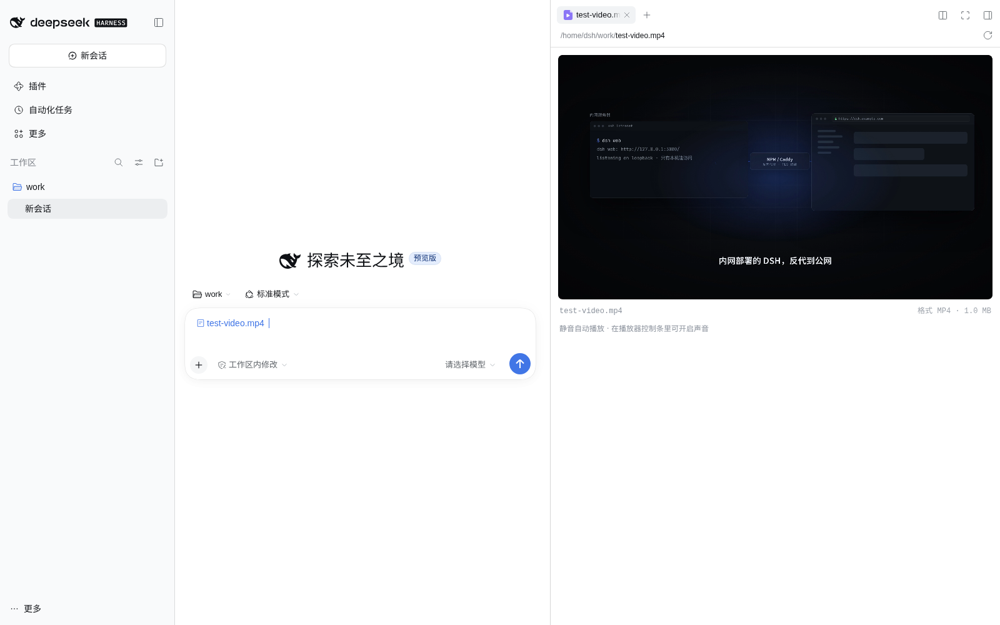

# dsh-video-preview

A **video preview** for the [DeepSeek Harness](https://github.com/deepseek-ai/deepseek-harness) (DSH) Web UI sidebar. Click an `.mp4`, `.webm` or `.mov` in the file tree, an `@` reference, or the workspace-changes list, and it plays in place — instead of "preview is not available for this file type yet".

DSH's built-in document preview registers text, PDF, Excel and images. **Video is not one of them.** This plugin adds that renderer: `mp4` / `m4v` / `webm` / `ogv` / `ogg` / `mov`.



> 中文说明：[README.zh.md](README.zh.md)

## Features

- **Click and play** — suffix-matched renderer that streams the file from an authenticated host route.
- **True streaming (v0.2)** — the `<video>` element talks to a byte-range route (`206 Partial Content`), so **seeking is instant and file size has no complete-read cap**: a 5 GB video costs only the bytes you actually watch.
- **Muted autoplay** — browsers refuse audible autoplay, so the preview starts silently; the native controls unmute in one click.
- **Useful metadata** — filename, container format, size (from a stat route).
- **Readable failures** — an unsupported codec or container says so instead of showing a blank player.
- **Zero runtime dependencies** — React comes from the host; everything else is standard Node/browser API. **No build step**: the browser half is a hand-written `__ModuleLoader__` module.
- **No host coupling** — the browser half registers through the public `documentPreviews` / `slots` / `locale` services; the host half through `connection.fetch` routes inside the same browser-auth fence as every other `/api` route.

## Install

```bash
# from a local checkout
dsh plugin --profile web add /path/to/dsh-video-preview

# from GitHub, pinned to a release — recommended
dsh plugin --profile web add "github:lvxianchao/dsh-video-preview#v0.2.0"
```

Restart `dsh` afterwards (the Web UI reloads its frontend modules on boot):

```bash
sudo systemctl restart dsh-web   # adapt to your deployment
```

The package declares `dsh.bundle`, so installing it appends the package to the profile's bundle list and mounts the row automatically — **no `cordis.patch.yml` edit needed**.

To try it without touching a profile, use an overlay:

```bash
dsh --profile web --patch ./dev.yml --host 127.0.0.1 --port 3099 --no-open
```

```yaml
# dev.yml
- insert:
    - id: video-preview
      name: '/absolute/path/to/dsh-video-preview/lib/index.js'
```

## Use

1. Type `@` in the composer and pick a video file (or open one from the workspace changes).
2. Click the file reference; the right sidebar opens a player and starts muted playback.
3. Drag, unmute, go fullscreen with the native controls. Seeking fetches only the bytes around the new position.

## Configuration

| Key | Default | Meaning |
|---|---|---|
| `rangeBytes` | `2097152` (2 MiB) | Byte window served per stream request. The browser issues consecutive ranges as it plays, so this is a latency/throughput knob, not a size limit. |

```yaml
# ~/.dsh/profiles/web/cordis.patch.yml
- id: video-preview
  config:
    rangeBytes: 4194304   # 4 MiB windows
```

## Limitations

| Limit | Cause | Workaround |
|---|---|---|
| No `mkv` | Chrome cannot decode Matroska | Remux to mp4/webm |
| Codec-dependent | The browser only plays what the platform decodes; HEVC/AV1 vary | H.264/AAC mp4 is the safe choice |
| Session must resolve | The stream route resolves the file through the session named in the file address | Previewing files from a live session always resolves; a vanished session 404s |
| Authenticated browsers only | Routes live behind the same auth fence as the rest of `/api` | That is the point — no unauthenticated file serving |

## How it works

| Half | File | Role |
|---|---|---|
| Host | `lib/index.js` | Registers `GET/HEAD /api/video-preview.stream` (byte ranges via `workspaceFiles.readBytes(range)`, `206` + `Content-Range`) and `GET /api/video-preview.stat` (size/version/type) on `connection.fetch` |
| Browser | `lib/client.js` | Registers the renderer metadata (`loading: "renderer"`) and the keyed document body; renders `<video src=…>` pointed at the stream route and reports its loaded version |

The renderer uses `loading: "renderer"`, so the preview framework never performs a complete-byte read for video files — that is what removes the platform's 32 MB complete-file cap from the video path.

The browser half needs no build step — it is a module in the host loader's own format:

```js
window.__ModuleLoader__.load({ id: "@lvxianchao/dsh-video-preview", factory: (require) => { /* … */ } });
```

## Development

```bash
# shadow instance: isolated DSH_HOME, never touches the live profile or its data
DSH_HOME=/tmp/dsh-test-home dsh --profile web \
  --patch ./test/shadow.patch.yml --host 127.0.0.1 --port 3199 --no-open
```

`test/shadow.patch.yml` mounts the plugin by path; `test/e2e.mjs` drives headless Chrome through "@ reference → click → assert the `<video>` plays, serves 206 ranges, and can seek near the end of a file bigger than the old 32 MB cap".

## Changelog

- **v0.2.0** — streaming: byte-range host routes (`/api/video-preview.stream`, `/api/video-preview.stat`), renderer-owned loading, no complete-file size cap, `rangeBytes` config.
- **v0.1.0** — first release: Blob-based playback of complete bytes (32 MB platform cap applied).

## License

MIT
