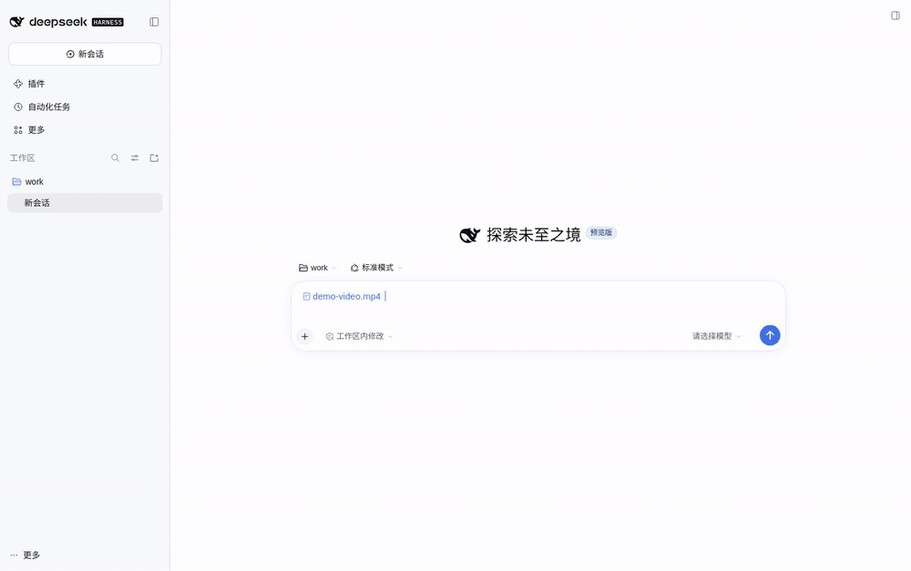

# dsh-video-preview

给 [DeepSeek Harness](https://github.com/deepseek-ai/deepseek-harness)（DSH）Web UI 的侧边栏加一个**视频预览器**：文件树 / `@` 引用 / 工区变更里点开 `.mp4`、`.webm`、`.mov`，直接就地播放，不再落到"该格式文件暂时无法预览"。

DSH 自带的文档预览只注册了文本、PDF、Excel 和图片——**没有视频**。这个插件补上这一格：`mp4` / `m4v` / `webm` / `ogv` / `ogg` / `mov`。



> English: [README.md](README.md)

## 特性

- **点开即播**：按后缀匹配渲染器，从带鉴权的宿主路由流式取流，不经过第三方服务。
- **真·流式**：`<video>` 直接打字节范围路由（`206 Partial Content`），**拖动进度条即时响应，文件大小没有完整读取上限**——5 GB 的片子也只消耗你实际看的那部分字节。
- **静音自动播放**：浏览器不允许有声自动播放，所以先静音起播，控制条里一键开声音。
- **基础信息**：文件名、容器格式、体积（来自 stat 路由）。
- **失败可读**：编码/封装不受支持时给出明确提示，而不是空白播放器。
- **零运行时依赖**：React 由宿主提供，其余全是标准 Node/浏览器 API；**没有构建步骤**，浏览器半是手写的 `__ModuleLoader__` 模块。
- **不碰宿主代码**：浏览器半只走公开服务 `documentPreviews` / `slots` / `locale`；宿主半通过 `connection.fetch` 注册路由，和其他 `/api` 路由一样位于浏览器鉴权栅栏之后。

## 安装

```bash
dsh plugin --profile web add "github:lvxianchao/dsh-video-preview"
```

`main` 只放已发布的代码，所以这条命令装到的就是最新稳定版。装完重启 `dsh`（Web UI 在启动时重载前端模块）：

```bash
sudo systemctl restart dsh-web   # 按你的部署方式替换
```

包内声明了 `dsh.bundle`，安装时会被自动加进 profile 的 bundle 列表并挂载，**不需要手改 `cordis.patch.yml`**。

想临时试又不想改 profile，可以用覆盖层：

```bash
dsh --profile web --patch ./dev.yml --host 127.0.0.1 --port 3099 --no-open
```

```yaml
# dev.yml
- insert:
    - id: video-preview
      name: '/absolute/path/to/dsh-video-preview/lib/index.js'
```

## 使用

1. 在会话里输入 `@`，选一个视频文件（或从工区变更列表里点开）。
2. 点击文件引用，右侧预览栏出现播放器，静音自动播放。
3. 控制条里拖进度、开声音、全屏；拖动只拉取新位置附近的字节。

## 配置

| 键 | 默认值 | 含义 |
|---|---|---|
| `rangeBytes` | `2097152`（2 MiB） | 单次流请求返回的字节窗口。浏览器按需连续发 Range，所以这只是延迟/吞吐调节钮，不是大小限制。 |

```yaml
# ~/.dsh/profiles/web/cordis.patch.yml
- id: video-preview
  config:
    rangeBytes: 4194304   # 4 MiB 窗口
```

## 限制

| 限制 | 原因 | 怎么办 |
|---|---|---|
| 不支持 `mkv` | Chrome 解不了 Matroska | 转成 mp4/webm |
| 编码受限 | 浏览器只认平台自带解码器；HEVC/AV1 等看平台 | 用 H.264/AAC 的 mp4 最稳 |
| 会话必须可解析 | 流路由按文件地址里的会话解析文件 | 从活跃会话预览总是可解析；会话消失则 404 |
| 仅限已鉴权浏览器 | 路由和其他 `/api` 一样在鉴权栅栏之后 | 这正是设计目的——绝无未鉴权的文件出口 |

## 实现

| 半 | 文件 | 职责 |
|---|---|---|
| 宿主 | `lib/index.js` | 在 `connection.fetch` 上注册 `GET/HEAD /api/video-preview.stream`（经 `workspaceFiles.readBytes(range)` 出字节，`206` + `Content-Range`）和 `GET /api/video-preview.stat`（size/version/type） |
| 浏览器 | `lib/client.js` | 注册渲染器元数据（`loading: "renderer"`）与键控文档体；渲染 `<video src=…>` 直连流路由，并上报加载版本 |

渲染器用的是 `loading: "renderer"`——预览框架因此**永远不会**对视频文件做完整字节读取，平台那 32 MB 的完整文件上限就从视频路径上消失了。

浏览器半没有构建步骤，直接是宿主加载器的模块格式：

```js
window.__ModuleLoader__.load({ id: "@lvxianchao/dsh-video-preview", factory: (require) => { /* … */ } });
```

## 相关插件

[dsh-web-guard](https://github.com/lvxianchao/dsh-web-guard) —— 同一作者的 DSH Web UI 密码登录：让它能安全地开放到外网，凭密码从任何地方访问，不再依赖每次重启都会变的临时 token，反向代理的兼容问题也已处理好。本插件只改变"文件怎么预览"，不改变"谁能进来"：如果这个 UI 不只是回环访问，请在它前面放 dsh-web-guard。

```bash
dsh plugin --profile web add @lvxianchao/dsh-web-guard
```

## 开发

`main` 是发布分支，只放已发布并打过 tag 的代码；日常开发在 `dev` 分支，确认发版时才合并回 `main`。

```bash
git checkout dev
# … 修改、提交、测试 …
git checkout main && git merge --ff-only dev
git tag -a vX.Y.Z && git push origin main --tags
```

影子实例（独立 `DSH_HOME`，不碰线上 profile 与数据）：

```bash
DSH_HOME=/tmp/dsh-test-home dsh --profile web \
  --patch ./test/shadow.patch.yml --host 127.0.0.1 --port 3199 --no-open
```

`test/shadow.patch.yml` 把插件按路径插进影子实例；`test/e2e.mjs` 用无头 Chrome 走"@ 引用 → 点开 → 断言 `<video>` 在播放、路由返回 206 Range、并且能把一个超过旧 32 MB 上限的文件拖到接近结尾"；`test/record-demo.mjs` 用同一条流程录制 `docs/demo.gif`（需要 `puppeteer-core` 和 Chrome）。

要验证经过鉴权闸门的流式路径（也就是生产拓扑），把 [dsh-web-guard](https://github.com/lvxianchao/dsh-web-guard) 装进同一个影子 profile，用 `test/guard.patch.yml` 启动，再跑 `test/e2e-guard.mjs`：它会登录、打开视频，并断言 `206` + `Content-Range` 穿过代理后依然正常。

## 赞助

如果这个插件帮你省了时间，欢迎请我喝杯咖啡：

- ☕ **[爱发电](https://afdian.com/a/lvxianchao)** — 国内，微信 / 支付宝
- 🌍 **[Ko-fi](https://ko-fi.com/lvxianchao)** — 海外，PayPal

<details>
<summary>微信赞赏码</summary>

<p align="center"></p>

</details>

## 变更记录

- **1.0.0** — 首个稳定版：字节范围流式宿主路由、渲染器自有加载、无完整文件大小上限、`rangeBytes` 配置。
- **0.1.0** — 预览版：Blob 播放完整字节（受平台 32 MB 上限约束）。

## License

MIT
